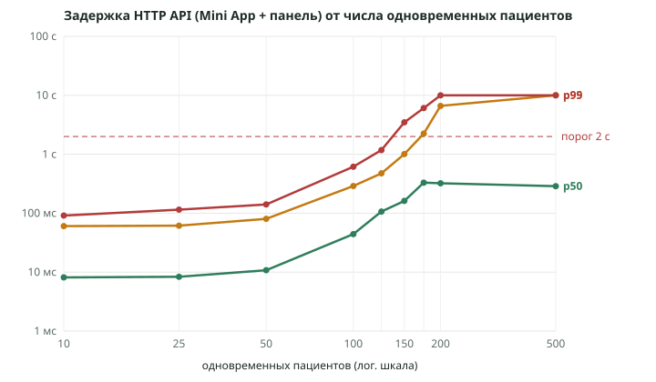

# Нагрузочное тестирование «Демо-Мед»

Ветка `claude/load-test`, замеры 27–28.10.2026. Все прогоны — на локальной машине с
тестовыми базами и вымышленными пациентами. Продакшен, VPS, рабочая база, ВКонтакте и
OpenAI не затрагивались. Скрипты — `scripts/load/`, параллельная обработка бота и её
замеры — `docs/vk-bot-concurrency-report.md` (ветка `claude/bot-concurrency`).

## 1. Итог

| Вопрос                                                                          | Ответ по замерам                                                                                                                                                                                               |
| ------------------------------------------------------------------------------- | -------------------------------------------------------------------------------------------------------------------------------------------------------------------------------------------------------------- |
| Сколько одновременно активных пациентов в Mini App при p95 < 2 с и ошибках < 1% | **≈ 150** на один экземпляр (на 150 — p95 0,9–1,1 с, ошибок 0%; на 175 — p95 1,5–3,0 с, нестабильно; на 200 — 4,6–7,6 с и ~2% тайм-аутов)                                                                      |
| Сколько пациентов выдерживает VK-бот текущей версии (`main`)                    | Без OpenAI — **≈ 50** (p95 0,7 с; на 100 — 5,7 с). С OpenAI (допущение 1,5 с на ответ) — **меньше 10**: уже на 10 p95 10,6 с. После изменений ветки `claude/bot-concurrency` — ≈ 100 и ≈ 50–100 соответственно |
| Первое узкое место HTTP                                                         | **Процессор одного процесса Node.js**: `next start` упирается в одно ядро (CPU 98–102%) при ~65–70 запросах в секунду. SQLite узким местом не был                                                              |
| Первое узкое место бота                                                         | **Последовательная обработка событий ВКонтакте** (CPU 9–13%): каждое сообщение ждёт отправки предыдущего                                                                                                       |
| Двойные записи                                                                  | **0** во всех прогонах, в том числе 500 одновременных попыток записаться на одно время                                                                                                                         |
| 20 клиник на одной машине                                                       | Только как 20 отдельных экземпляров (многоклиентской архитектуры в коде нет): 4,4 ГБ памяти в покое, 6,6–7,1 ГБ под нагрузкой; на 2 ядрах — до ~100 активных пациентов на все клиники при p95 < 0,4 с          |

## 2. Условия и ограничения результатов

- **Тестовая машина:** 4 vCPU Intel Xeon 2,1 ГГц, 16 ГБ RAM, Node.js 22, Linux. Сервер
  закреплён за 2 ядрами (`taskset`), генератор нагрузки — за двумя другими.
- **Действующий VPS:** в документах указано только **2 ГБ RAM** (`docs/admin-panel-deploy.md`,
  раздел 4); число и тип ядер в репозитории не указаны — сравнение по CPU с VPS
  невозможно. Процесс Node.js использует одно ядро, поэтому важна скорость одного ядра
  VPS, а не их число.
- Генератор и сервер на одной машине; сеть — локальная (нет задержек интернета и
  прокси). На VPS время ответа будет больше на сетевую задержку пациента.
- Внешние сервисы в тесте бота — заглушки: `messages.send` — 100 мс, OpenAI — 1,5 с. Это
  **допущения**, а не замеры ВКонтакте и OpenAI.
- Поведение пациентов смоделировано (см. 3); реальная интенсивность неизвестна.
- Сборка — production (`npm run build`, `next start`), один процесс — сайт, панель и Mini
  App вместе, как на сервере.

## 3. Методика

- **Модель — закрытый цикл:** каждый виртуальный пациент ждёт ответа и «думает» 1–3 с
  между действиями. Поэтому число одновременных пациентов и запросы в секунду (RPS) —
  разные величины: RPS измеряется.
- **Смесь действий пациента (Mini App):** главный экран (врачи с ближайшим временем) →
  свободные дни врача → свободное время → в 60% случаев запись → «Мои записи» → в 30%
  перенос, в 30% отмена. Плюс 2 администратора панели: главная, записи на неделю,
  расписание врача, свободное время — раз в 3–6 с.
- **Уровни:** 10, 25, 50, 100, 200, 500 одновременных пациентов (и 125, 150, 175 для
  поиска порога); по 3 повтора (100, 125, 150, 175 — по 2). Прогрев 15 с, замер 45 с,
  свежая копия тестовой базы и перезапуск сервера на каждый прогон.
- **Ошибка** — ответ 5xx, обрыв соединения или тайм-аут 10 с. 409 «время занято» и
  «лимит активных записей пациента» — ожидаемый отказ, считается отдельно. Ответов 429
  (лимит частоты Mini App) не было.
- **CPU и память** — по `/proc` процесса сервера раз в секунду; 100% = одно ядро.
- **Двойные записи** — запрос к базе после прогона: больше одной активной записи на
  врача, дату и время.
- **Гонка за слот:** N пациентов одновременно записываются на одно время, 3 раунда.

## 4. HTTP: Mini App и панель (один экземпляр)

Медиана повторов; p95 — медиана и разброс; CPU — среднее / максимум за секунду;
записи — сумма по повторам (успешные / отказ 409).

| Пациентов | Повторов | RPS  | p50    | p95                 | p99    | Ошибки | CPU         | Память, макс. | Записи    | Двойных |
| --------- | -------- | ---- | ------ | ------------------- | ------ | ------ | ----------- | ------------- | --------- | ------- |
| 10        | 3        | 5,5  | 8 мс   | 60 мс (55–65 мс)    | 91 мс  | 0%     | 9% / 28%    | 329 МБ        | 69 / 5    | 0       |
| 25        | 3        | 12,9 | 8 мс   | 61 мс (58–69 мс)    | 115 мс | 0%     | 19% / 41%   | 350 МБ        | 167 / 15  | 0       |
| 50        | 3        | 25,3 | 11 мс  | 80 мс (73–96 мс)    | 141 мс | 0%     | 39% / 79%   | 364 МБ        | 335 / 34  | 0       |
| 100       | 2        | 48,7 | 44 мс  | 289 мс (214–364 мс) | 614 мс | 0%     | 76% / 104%  | 428 МБ        | 394 / 73  | 0       |
| 125       | 2        | 57,9 | 106 мс | 475 мс (467–482 мс) | 1,2 с  | 0%     | 93% / 109%  | 435 МБ        | 443 / 115 | 0       |
| 150       | 2        | 65,5 | 162 мс | 1,0 с (0,9–1,1 с)   | 3,5 с  | 0%     | 98% / 109%  | 472 МБ        | 504 / 150 | 0       |
| 175       | 2        | 67,8 | 330 мс | 2,2 с (1,5–3,0 с)   | 6,1 с  | 0%     | 102% / 112% | 467 МБ        | 490 / 182 | 0       |
| 200       | 3        | 68,2 | 322 мс | 6,6 с (4,6–7,6 с)   | 10 с   | 2,1%   | 102% / 111% | 471 МБ        | 764 / 264 | 0       |
| 500       | 3        | 74,0 | 287 мс | 10 с (тайм-аут)     | 10 с   | 45,2%  | 102% / 110% | 473 МБ        | 302 / 18  | 0       |



- До 50 пациентов задержка почти не меняется; RPS растёт линейно (~0,5 запроса в секунду
  на пациента).
- С 100 пациентов процесс приближается к одному ядру; с 175 — упирается в него: RPS
  перестаёт расти (~68–74), очередь запросов растёт, на 200 появляются тайм-ауты.
- Память процесса — 0,32–0,47 ГБ и почти не зависит от нагрузки.
- **Самый тяжёлый запрос — главный экран Mini App** (`GET /api/miniapp/clinic`): при 50
  пациентах p50 53 мс против 5–14 мс у остальных; он считает ближайшее свободное время
  каждого врача. По времени ответа и доле запросов — оценка ≈ 60% процессорного времени
  сервера. Кэширование этого ответа — самое дешёвое ускорение (оценка, не замер).
- Под перегрузкой страдает и панель: у администраторов p95 до 3,7 с на 150 пациентах —
  один процесс на всех.

## 5. Гонка за одно время

| Одновременно | Успешных по раундам | p50    | p95    | p99    | Двойных |
| ------------ | ------------------- | ------ | ------ | ------ | ------- |
| 10           | 1 / 1 / 1           | 38 мс  | 73 мс  | 76 мс  | 0       |
| 50           | 1 / 1 / 1           | 140 мс | 273 мс | 300 мс | 0       |
| 200          | 1 / 1 / 1           | 435 мс | 772 мс | 841 мс | 0       |
| 500          | 1 / 1 / 1           | 1,1 с  | 1,9 с  | 2,1 с  | 0       |

Остальные получили 409 «время занято»; ошибок сервера нет. Ранее (аудит демонстрации):
8 отдельных процессов одновременно на 5 одинаковых слотов — по одной записи на слот.

## 6. SQLite

- Сообщений о блокировках (`database is locked`, `SQLITE_BUSY`) в журналах сервера — 0 во
  всех прогонах.
- Запись (POST/PATCH) отвечает так же быстро, как чтение (p50 7–9 мс при 50 пациентах);
  под перегрузкой растут все запросы одинаково — ждут процессор, а не базу.
- Режим WAL, `busy_timeout` 5 с. Важная особенность: `node:sqlite` синхронный — ожидание
  блокировки останавливает весь процесс. На измеренных уровнях это не проявилось.
- Вывод: при одном сервере SQLite не узкое место; PostgreSQL нужен только для
  нескольких серверов (`docs/scaling-plan.md`).

## 7. VK-бот

Отдельный процесс, события Bots Long Poll. Тест — `scripts/load/bot-load.mts`: настоящий
код канала и бота, заглушки сервера Long Poll, VK API (100 мс) и OpenAI (1,5 с).
Пациенты пишут после ответа, пауза 3–10 с.

**Текущая версия (последовательная обработка):**

| Пациентов | Режим     | Ответов/с | p50    | p95    | Очередь, макс. | Тайм-ауты (30 с) | CPU |
| --------- | --------- | --------- | ------ | ------ | -------------- | ---------------- | --- |
| 10        | правила   | 1,53      | 110 мс | 187 мс | 2              | 0                | 2%  |
| 50        | правила   | 7,48      | 228 мс | 688 мс | 12             | 0                | 7%  |
| 100       | правила   | 8,93      | 4,7 с  | 5,7 с  | 91             | 0                | 9%  |
| 200       | правила   | 8,68      | 16,4 с | 18,6 с | 246            | 0                | 11% |
| 500       | правила   | 7,92      | 12,2 с | 27,8 с | 889            | 515              | 13% |
| 10        | с моделью | 1,12      | 208 мс | 10,6 с | 10             | 0                | 2%  |
| 25        | с моделью | 0,32      | 17,2 с | 29,9 с | 42             | 26               | 2%  |
| 50        | с моделью | 0,57      | 16,4 с | 28,3 с | 116            | 53               | 1%  |

Потолок — ~9 сообщений в секунду (1 / ~0,11 с на сообщение) без модели и ~0,6 с моделью:
события обрабатываются по одному, процессор свободен. Исправлено в ветке
`claude/bot-concurrency` (параллельно по пациентам, порядок — внутри пациента): без
модели — 15 ответов в секунду (лимит VK API), p95 на 100 пациентах 0,64 с; с моделью —
p95 1,6 с на 50 и 3,5 с на 100 пациентах. Полные таблицы — `docs/vk-bot-concurrency-report.md`.

Память процесса бота — 120–260 МБ.

## 8. 20 клиник

**Важно:** многоклиентской архитектуры в коде нет — один процесс обслуживает одну
клинику (одна база `BOT_DB_PATH`). Поэтому 20 клиник смоделированы как **20 отдельных
экземпляров** `next start` со своими тестовыми базами, разными часами приёма врачей
(`prepare.mts --variant`) и разным числом пациентов — это не изоляция внутри одной
системы. Все 20 — на тех же 2 ядрах; у каждой клиники 1 администратор.

| Всего пациентов (на клинику) | RPS всех | p95 по клиникам (мин–медиана–макс) | Ошибки, макс. по клинике | CPU всех | Память в покое | Память под нагрузкой | Двойных |
| ---------------------------- | -------- | ---------------------------------- | ------------------------ | -------- | -------------- | -------------------- | ------- |
| 100 (2–8)                    | 54,8     | 105 – 155 – 382 мс                 | 0%                       | 116%     | 4,4 ГБ         | 6,6 ГБ               | 0       |
| 200 (4–16)                   | 89,9     | 0,75 – 1,1 – 2,8 с                 | 2,4%                     | 198%     | 4,4 ГБ         | 7,1 ГБ               | 0       |

- Один экземпляр в покое — 219–222 МБ; 20 экземпляров **не помещаются в 2 ГБ** и даже в 4 ГБ.
- 20 процессов используют оба ядра (CPU до 198%), поэтому суммарно обслуживают больше,
  чем один процесс (90 против ~68 RPS), — но при 200 пациентах на все клиники ядра
  заняты полностью, у части клиник p95 > 2 с.
- Боты в этом прогоне не запускались: по замерам раздела 7 — ещё 120–260 МБ на клинику.

**Оценка будущей общей платформы (не замер):** один процесс на много клиник не тратит
220 МБ на клинику, но упирается в одно ядро так же, как в разделе 4 (~65–70 RPS ≈ 150
активных пациентов на процесс). Для 20+ клиник нужно несколько процессов (по ядрам) и
кэширование тяжёлых запросов; тогда на 4 vCPU — порядка 3–4 процессов × ~150 активных
пациентов. Это расчёт по замерам одного процесса, проверять — после переделки.

## 9. Ресурсы VPS для 5, 10 и 20 клиник

Расчёт по замерам (память экземпляра сайта/панели/Mini App 0,22–0,47 ГБ, бота 0,12–0,26 ГБ;
1 ядро на ~150 активных пациентов Mini App) при текущей архитектуре «экземпляр на
клинику». Это **оценка**, не замер на VPS; запас на ОС, nginx и сборку не включён
(сборка `next build` — до 1–1,5 ГБ, её лучше делать на другой машине).

| Клиник | Процессов      | Память (покой → нагрузка)                        | vCPU | Вывод                                                         |
| ------ | -------------- | ------------------------------------------------ | ---- | ------------------------------------------------------------- |
| 1      | 1 сайт + 1 бот | ~0,35 → 0,7 ГБ                                   | 1–2  | Текущий VPS 2 ГБ достаточен                                   |
| 5      | 5 + 5          | ~1,7 → 3,7 ГБ                                    | 2    | Нужен VPS не меньше 4 ГБ; 2 ГБ не хватит                      |
| 10     | 10 + 10        | ~3,4 → 7,3 ГБ                                    | 2–4  | 8 ГБ                                                          |
| 20     | 20 + 20        | ~6,8 → 12 ГБ (замер сайтов: 4,4 → 7,1 ГБ + боты) | 4    | 16 ГБ; на 2 ядрах — до ~100 активных пациентов на все клиники |

Подробное сравнение конфигураций 4/8/16 vCPU, экономика и план — `docs/scaling-plan.md`.

## 10. Что нужно для масштабирования

1. **Параллельная обработка бота** — сделано в ветке `claude/bot-concurrency`
   (ожидает решения владельца).
2. **Кэш главного экрана Mini App** (ближайшее время врачей): самый тяжёлый запрос,
   ~60% процессорного времени по оценке.
3. **Несколько процессов на сервер** (по числу ядер) за nginx: один процесс Node.js
   использует одно ядро. SQLite в режиме WAL допускает это на одном сервере; лимиты
   частоты и вход в панель сейчас в памяти процесса — их нужно учитывать.
4. **Многоклиентская архитектура** (одна платформа, база на клинику или общая база с
   изоляцией) — чтобы не тратить ~0,35–0,7 ГБ на каждую клинику. Изменение
   архитектуры — после согласования.
5. **PostgreSQL** — только при нескольких серверах; на одном сервере SQLite справляется.

## 11. Как повторить

```bash
npm run build
LOAD_ADMIN_PASSWORD=<пароль тестового сотрудника> node scripts/load/run-http.mjs \
  --levels=10,25,50,100,200,500 --repeats=3 --out=.data/load
node scripts/load/chart.mjs --in=.data/load/summary.json --out=docs/load-test-latency.svg
LOAD_ADMIN_PASSWORD=… node scripts/load/run-clinics.mjs --clinics=20 \
  --patients=2,2,3,… --out=.data/load-clinics
node scripts/load/run-bot.mjs --template=.data/load/template.sqlite --out=.data/load-bot
```

Только на локальной машине или отдельном тестовом сервере — не на продакшене.
